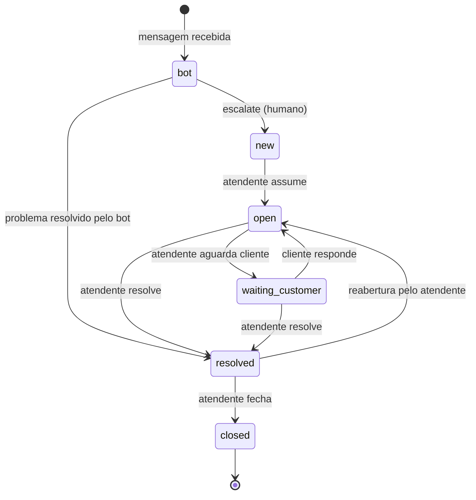
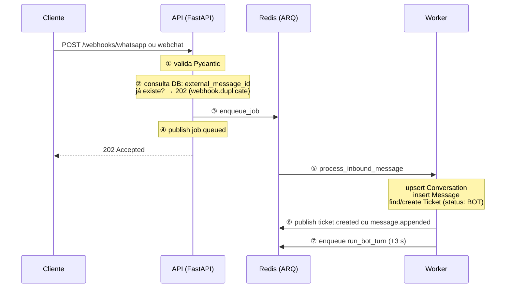
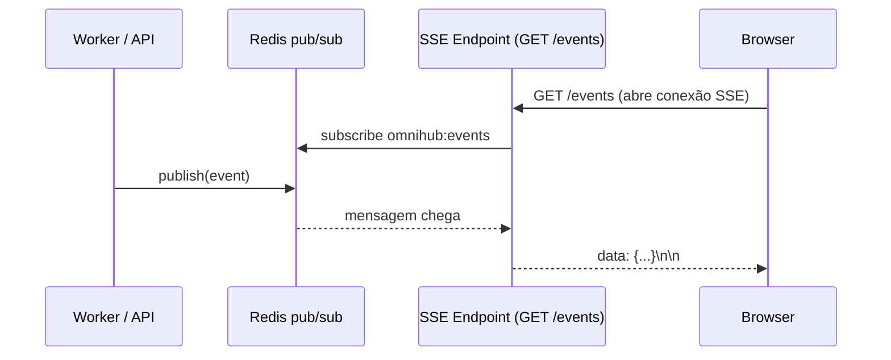

# Omnihub

Atendimento **omnichannel**: recebe mensagens de WhatsApp e webchat via webhook, normaliza em um domínio único, processa em fila e entrega para o atendente numa mesa (React) atualizada ao vivo por SSE, além da API REST.

Projeto pessoal construído para demonstrar domínio de back-end Python assíncrono, integração via fila, e uma interface de operação em cima da mesma API.

---

## Por que isso existe

Plataformas de atendimento como as da VulcaNet recebem eventos de WhatsApp, voz, redes sociais e chat do site simultaneamente. Cada canal tem um formato de payload diferente. O Omnihub simula o núcleo desse tipo de plataforma: um gateway de ingestão que normaliza eventos heterogêneos em um modelo único (`Conversation` → `Message` → `Ticket`) e os processa de forma assíncrona via fila.

---

## Decisões de design


| Decisão                                                                           | Alternativa considerada                    | Por quê essa                                                                                                                                   |
| --------------------------------------------------------------------------------- | ------------------------------------------ | ---------------------------------------------------------------------------------------------------------------------------------------------- |
| **FastAPI**                                                                       | Flask, Django                              | Async nativo; gera OpenAPI/Swagger automaticamente a partir de type hints                                                                      |
| **ARQ + Redis** como fila                                                         | Celery + RabbitMQ; fila em tabela Postgres | ARQ é async-nativo e leve; combina com o event loop do FastAPI; Redis é atomic para pop de fila                                                |
| **PostgreSQL + SQLAlchemy 2.0 async**                                             | MongoDB; SQLite                            | SQL com relações claras (conversa → mensagens → ticket); SQLAlchemy 2.0 tem suporte nativo a async sem bloquear o event loop                   |
| `**create_all` no startup**                                                       | Alembic migrations                         | MVP deliberado; Alembic é o upgrade path (Nível 2) — marcado no código com `ponytail:` comment                                                 |
| **Resposta `202 Accepted` no webhook**                                            | Processar de forma síncrona                | A Meta reenvia o evento se não receber resposta rápida; processar de forma síncrona tornaria o endpoint sujeito a timeouts e duplicatas        |
| **Dedupe por `external_message_id`** (wamid no WhatsApp, `message_id` no webchat) | Apenas confiar na fila não reenviar        | Webhooks reais reenviam; a defesa precisa estar no endpoint (antes de enfileirar) E no worker (na escrita)                                     |
| **SQLite in-memory nos testes**                                                   | testcontainers + Postgres real             | Sem infraestrutura necessária para `pytest`; `Uuid` genérico do SQLAlchemy 2.0 é compatível com ambos                                          |
| **Featherless AI** como provedor de LLM                                           | OpenAI, Anthropic                          | API 100% compatível com OpenAI (troca só o `base_url`); dá acesso a modelos open-source sem lock-in de fornecedor                              |
| `**_job_id` determinístico** no `run_bot_turn`                                    | Permitir múltiplos jobs por ticket         | Uma única mensagem rápida por ticket; sem corrida de turnos simultâneos do bot para o mesmo ticket                                             |
| **Bot com status próprio (`bot`)**                                                | Bot como modo do status `new`              | Separa visualmente tickets sob atendimento automático de tickets aguardando humano; o board filtra `bot` para não poluir a fila dos atendentes |


---

## Arquitetura

```
                         ┌──────────────────────────────────────────────┐
  WhatsApp / webchat     │                                              │
  (ou a mesa simulando)─►│  POST /webhooks/whatsapp                     │
                         │  POST /webhooks/webchat                      │
                         │  ① valida payload (Pydantic)                 │
                         │  ② dedupe por external_message_id            │
                         │  ③ enfileira job no Redis                    │
                         │  ④ publica evento e responde 202             │
                         │                  │                           │
                         │         Redis (fila ARQ + pub/sub)           │
                         │                  │                           │
                         │     [worker ARQ — process_inbound_message]   │
                         │  ⑤ upsert Conversation                       │
                         │  ⑥ insere Message                            │
                         │  ⑦ cria Ticket (status: BOT) ou reutiliza   │
                         │  ⑧ enfileira run_bot_turn (+3 s)             │
                         │                  │                           │
                         │     [worker ARQ — run_bot_turn]              │
                         │  ⑨  carrega histórico da conversa            │
                         │  ⑩  chama BotAgentService → Featherless AI   │
                         │  ⑪  persiste resposta do bot                 │
                         │  ⑫  aplica transição: reply/resolved/escalate│
                         │  ⑬  envia msg ao cliente (WhatsApp Cloud API)│
                         │  ⑭  publica evento SSE                       │
                         │                  │                           │
  Cliente :5173          │  GET /board          PostgreSQL              │
  Mesa /mesa · /docs ───►│  GET /events  (SSE)                          │
                         │  GET /tickets  ·  GET /tickets/{id}          │
                         │  POST /tickets/{id}/transition               │
                         │  POST /tickets/{id}/messages                 │
                         └──────────────────────────────────────────────┘
```

O worker publica no canal `omnihub:events`. `GET /events` assina esse canal com uma conexão Redis própria (o pool do ARQ fica livre para enfileirar) e encaminha os eventos ao navegador.

```
app/
  api/          rotas FastAPI (health, board, stream, tickets, webhooks)
  domain/       entidades puras + máquina de estados (sem DB)
  db/           modelos SQLAlchemy 2.0 async + sessão
  workers/      tasks ARQ (WhatsApp e inbound genérico) + WorkerSettings
  services/     BotAgentService (Featherless AI) + WhatsAppSenderService
  events.py     cartão do quadro e publicação no canal Redis
  core/         config (pydantic-settings)
frontend/       chat do cliente na raiz (`/`), mesa e quadro do atendente em `/mesa` (React + Vite)
tests/
  domain/       testes unitários da máquina de estados
  api/          testes HTTP (health, tickets, board, webchat, resposta)
  integration/  webhook → task → ticket, nos dois canais
  services/     testes do WhatsAppSenderService
```

---

## Pré-requisitos

- Docker Desktop instalado e **em execução**
- `git`

Nenhuma instalação de Python, Redis ou Postgres necessária — o Docker cuida de tudo.

---

## Como rodar

```bash
git clone https://github.com/glpalma/Omnihub.git
cd Omnihub

# Copiar configuração padrão (já pronto para uso local)
cp .env.example .env

# Subir todos os serviços (api + worker + frontend + postgres + redis)
docker compose up --build
```

Aguarde até ver `Application startup complete` nos logs da `api`. Então:

```bash
# Verificar que a API está saudável
curl http://localhost:8000/health
# → {"status":"ok"}

# Chat do cliente (tela inicial; /chat abre a mesma tela)
open http://localhost:5173

# Mesa de atendimento (conversas, resposta do atendente, quadro ao vivo)
open http://localhost:5173/mesa

# Documentação interativa (Swagger)
open http://localhost:8000/docs
```

---

## Exemplos de uso

### 1. Simular uma mensagem do WhatsApp (curl)

```bash
curl -s -X POST http://localhost:8000/webhooks/whatsapp \
  -H "Content-Type: application/json" \
  -d '{
    "object": "whatsapp_business_account",
    "entry": [{
      "id": "123",
      "changes": [{
        "field": "messages",
        "value": {
          "messaging_product": "whatsapp",
          "messages": [{
            "id": "wamid.ABC001",
            "from": "+5511999990001",
            "timestamp": "1700000000",
            "type": "text",
            "text": { "body": "Preciso de ajuda com meu pedido" }
          }]
        }
      }]
    }]
  }'
# → {"queued":true}
```

O worker processa o job em segundo plano. Após 1–2 segundos:

### 2. Listar tickets

```bash
curl -s http://localhost:8000/tickets | python3 -m json.tool
```

### 3. Filtrar por status ou canal

```bash
curl -s "http://localhost:8000/tickets?status=new&channel=whatsapp" | python3 -m json.tool
```

### 4. Ver detalhe com histórico de mensagens

```bash
# Substitua <TICKET_ID> pelo id retornado no passo anterior
curl -s http://localhost:8000/tickets/<TICKET_ID> | python3 -m json.tool
```

### 5. Mover o ticket pelo fluxo (máquina de estados)

```bash
# new → open
curl -s -X POST http://localhost:8000/tickets/<TICKET_ID>/transition \
  -H "Content-Type: application/json" \
  -d '{"target_status": "open"}'

# open → waiting_customer
curl -s -X POST http://localhost:8000/tickets/<TICKET_ID>/transition \
  -H "Content-Type: application/json" \
  -d '{"target_status": "waiting_customer"}'

# Transição inválida (ex: new → closed) retorna 422
curl -s -X POST http://localhost:8000/tickets/<TICKET_ID>/transition \
  -H "Content-Type: application/json" \
  -d '{"target_status": "closed"}'
# → {"detail":"Cannot transition from 'new' to 'closed'..."}
```

### 6. Teste de idempotência (reenvio com mesmo wamid)

```bash
# Enviar a mesma mensagem duas vezes com o mesmo id (wamid.ABC001)
# O segundo envio deve retornar 202 mas NÃO criar um ticket/mensagem duplicado
curl -s -X POST http://localhost:8000/webhooks/whatsapp \
  -H "Content-Type: application/json" \
  -d '{ "object": "whatsapp_business_account", "entry": [{ "id": "123", "changes": [{ "field": "messages", "value": { "messaging_product": "whatsapp", "messages": [{ "id": "wamid.ABC001", "from": "+5511999990001", "timestamp": "1700000000", "type": "text", "text": { "body": "Preciso de ajuda" } }] } }] }] }'
# → {"queued":true} — a mensagem já existe, sem segundo job
```

O webchat segue a mesma regra, usando `message_id` no lugar do wamid.

### 7. Simular o chat do site

```bash
curl -s -X POST http://localhost:8000/webhooks/webchat \
  -H "Content-Type: application/json" \
  -d '{
    "session_id": "sess-carla",
    "message_id": "webchat.ABC001",
    "text": "Oi pelo site"
  }'
# → {"queued":true}
```

O job na fila é `process_inbound_message`. O worker grava o canal `webchat` e usa `session_id` como identificador da conversa.

### 8. Responder como atendente

```bash
curl -s -X POST http://localhost:8000/tickets/<TICKET_ID>/messages \
  -H "Content-Type: application/json" \
  -d '{"body": "Olá, já estou vendo o seu pedido"}'
```

A resposta fica na conversa com `direction: "outbound"` e `sender: "atendente"`. Se o ticket está `new`, `waiting_customer` ou `resolved`, essa chamada também o leva para `open`. Ticket `closed` responde `422`.

### 9. Quadro e stream ao vivo

```bash
# Snapshot que a mesa carrega: cartões + transições permitidas
curl -s http://localhost:8000/board | python3 -m json.tool

# Server-Sent Events (job.queued, ticket.created, message.appended,
# ticket.transitioned, message.sent, webhook.duplicate, message.duplicate)
curl -N http://localhost:8000/events
```

---

## Rodar os testes

Os testes usam SQLite in-memory — **não precisam de Docker rodando**.

```bash
# Instalar uv se não tiver
pip install uv

# Rodar todos os 40 testes
uv run --extra dev pytest -v
```

---

## Fluxo de estados do Ticket




| Status             | Quem define                                        | Significado                                                          |
| ------------------ | -------------------------------------------------- | -------------------------------------------------------------------- |
| `bot`              | Worker, ao criar o ticket                          | Atendimento em curso pelo bot (não aparece no board para atendentes) |
| `new`              | Bot (escalate)                                     | Bot escalou; aguardando atendente humano                             |
| `open`             | Atendente ou bot (escalate sem escalação anterior) | Atendente está cuidando                                              |
| `waiting_customer` | Atendente                                          | Aguardando resposta do cliente                                       |
| `resolved`         | Atendente ou bot                                   | Problema resolvido; pode ser reaberto                                |
| `closed`           | Atendente                                          | Terminal — nenhuma transição permitida                               |


`closed` é terminal. `resolved` volta para `open` só pela ação do atendente.

Uma mensagem nova do cliente entra no ticket que ainda está `bot`, `new`, `open` ou `waiting_customer`, sem mudar o status. Se o ticket da conversa já está `resolved` ou `closed`, o worker cria outro ticket (status `bot`). Quem muda o status humano é o atendente, pela transição ou ao responder (`POST /tickets/{id}/messages` abre o ticket quando a transição para `open` é válida). O bot pode mudar o status de `bot` → `new` (escalate), `bot` → `resolved`.

Transições inválidas retornam `422 Unprocessable Entity` com mensagem descritiva.

---

## Possíveis dúvidas

### Como funciona o fluxo completo ao receber uma mensagem nova?




O webhook responde `202` imediatamente — a Meta/cliente não espera o processamento. A segunda linha de idempotência (passo ②) usa `external_message_id` (`wamid` no WhatsApp, `message_id` no webchat); a terceira linha é a constraint `UNIQUE` no banco, capturada via `IntegrityError` no worker.

---

### Como o bot decide escalar para um atendente humano?

O `run_bot_turn` carrega o histórico da conversa e chama `BotAgentService.run_turn()`, que monta as mensagens no formato de chat (inbound → `role: user`, outbound → `role: assistant`) e chama a [Featherless AI](https://featherless.ai) — uma API 100% compatível com a OpenAI.

O LLM responde **obrigatoriamente** com um JSON estruturado:

```json
{ "action": "reply",    "text": "..." }
{ "action": "resolved", "text": "..." }
{ "action": "escalate", "text": "...", "reason": "..." }
```


| Ação do LLM | Transição do ticket | O que o cliente recebe                             |
| ----------- | ------------------- | -------------------------------------------------- |
| `reply`     | permanece `bot`     | resposta do bot enviada ao canal                   |
| `resolved`  | `bot` → `resolved`  | mensagem de encerramento                           |
| `escalate`  | `bot` → `new`       | mensagem de transferência; ticket aparece no board |


O bot escala automaticamente quando: o cliente pede para falar com humano, o problema persiste após o checklist nível-1, o assunto é fatura/cancelamento, ou o limite de turnos (`BOT_MAX_TURNS`) é atingido. Qualquer erro na chamada ao LLM também gera escalação segura, para nunca deixar o cliente sem resposta.

O board React **oculta tickets com status `bot`** — eles só aparecem para atendentes após a escalação (`new`).

---

### Como o enqueue de jobs funciona?

O ARQ usa um pool Redis (`arq_pool`) disponível globalmente em `request.app.state.arq_pool`. Enfileirar é uma operação atômica e não-bloqueante:

```python
# Webhook → enfileira tarefa imediatamente
await arq_pool.enqueue_job("process_inbound_message", { ...data... })

# Worker → enfileira run_bot_turn com job_id determinístico e delay
await redis.enqueue_job(
    "run_bot_turn",
    { ...data... },
    _job_id=f"bot_turn_{ticket.id}",  # evita duplicatas para o mesmo ticket
    _defer_by=timedelta(seconds=3),   # delay para evitar colisão com flush do DB
)
```

O `_job_id` determinístico garante que múltiplas mensagens rápidas de um mesmo cliente não disparem múltiplos turnos simultâneos do bot para o mesmo ticket. O worker ARQ faz polling no Redis e executa os jobs em `asyncio`, compartilhando o mesmo event loop sem bloquear.

---

### Como o chat em tempo real funciona?

O frontend mantém **uma única conexão SSE** em `GET /events` durante toda a sessão. Eventos são publicados no canal Redis `omnihub:events` por qualquer parte do sistema:




O endpoint SSE usa **uma conexão Redis separada** (não o pool do ARQ) para não bloquear o enfileiramento de novos jobs. Os tipos de evento possíveis são:


| Evento                | Quando                                                |
| --------------------- | ----------------------------------------------------- |
| `job.queued`          | Webhook recebeu e enfileirou o job                    |
| `ticket.created`      | Worker criou um ticket novo                           |
| `message.appended`    | Worker inseriu mensagem em ticket existente           |
| `message.sent`        | Bot enviou resposta ao cliente                        |
| `ticket.transitioned` | Status do ticket mudou (bot→new, open→resolved, etc.) |
| `webhook.duplicate`   | Webhook recebeu wamid/message_id já visto             |
| `message.duplicate`   | Worker detectou mensagem duplicada via IntegrityError |


O board React re-renderiza os cartões de ticket ao receber eventos sem precisar de polling ou refresh de página.

---

### Como o SSE dos tickets é implementado?

`GET /events` é uma rota FastAPI que retorna um `StreamingResponse` com `Content-Type: text/event-stream`. Internamente:

1. Abre uma conexão Redis dedicada e assina o canal `omnihub:events` via `pubsub.subscribe()`.
2. Entra em um loop assíncrono aguardando mensagens com `await pubsub.get_message(timeout=1)`.
3. Cada mensagem é serializada para o formato SSE (`data: <json>\n\n`) e enviada ao cliente.
4. Se a conexão HTTP cair (cliente fechou a aba, timeout), o gerador é fechado e a conexão Redis é liberada.

Isso mantém o número de conexões Redis proporcional ao número de abas abertas (tipicamente uma por atendente), sem qualquer estado em memória no processo da API.